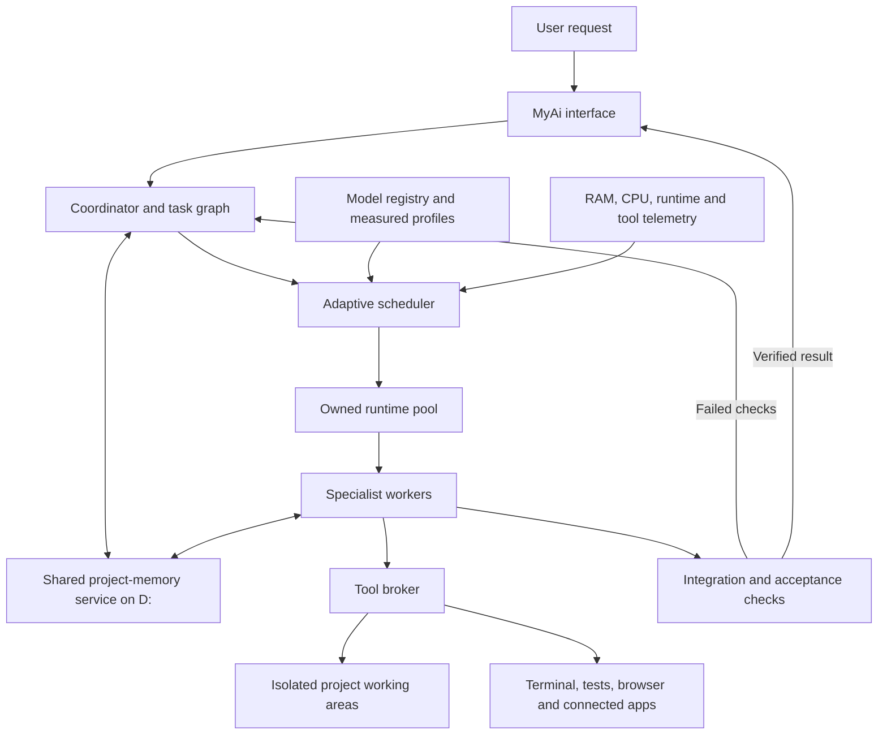

# MyAi Powerhouse — Executable Master Plan

**Requested filename:** `Powehouse.md`  
**Prepared for:** Saksham  
**Date:** 2 October 2026  
**Status:** Implementation started; baseline work and the first project-memory increment are complete. Team orchestration and adaptive concurrency remain to be implemented.  
**Primary application:** [saksham001k/MyAi](https://github.com/saksham001k/MyAi), currently branded KISS in its README.  
**Companion:** The existing local Earthma source-memory service.

## Implementation log — 2 October 2026

- Preserved the existing MyAi diagnostic change and built isolated development copies.
- Backed up and restore-checked three current databases; inventoried and hashed the three installed model assets and native runtime.
- Verified real generation using both Qwen2.5 Coder configurations and a basic Qwen3 4B load/generation check on CPU.
- Installed structured project briefs, acceptance checks, revisioned decisions, conflict reporting, source manifests, and handoffs in the existing local MyAi and Earthma applications.
- Created the separate `D:\AI\earthma-memory\powerhouse.sqlite3` project store and a Project memory panel. Linked project tasks receive saved state and publish report references/hashes with actual verification status.
- Installed regression suites pass: 135 MyAi tests with five existing optional/platform skips, and 76 Earthma tests. The nine-check synthetic cross-model/restart probe and five browser workflow checks passed.
- This increment does not implement a model team, automatic continuation of interrupted tools, semantic retrieval for all existing facts, or a concurrency speed improvement. The next work package is the task graph and sequential specialist workflow, followed by the runtime pool and measured adaptive scheduling.

The numbered sections below remain the executable target architecture and release gates. Proposed components are not all implemented merely because this log records an initial increment.

## 1. Product goal and agreed behavior

Turn MyAi into the main workspace for the user's downloaded local models. The user gives one outcome-oriented instruction; MyAi plans the work, assigns suitable workers, provides relevant shared context, executes tools, verifies results, and saves enough state to continue later with another model.

**Adaptive concurrency is a core requirement:** small requests normally use one model worker. Larger requests may use two or more simultaneous workers when independent work exists and the machine can support it. The active number must change during a run; it is neither permanently one nor automatically equal to the number of downloaded models.

Example: “Build me a library management app.” MyAi should establish requirements and interfaces, assign backend and frontend work, prepare tests, integrate the changes, repair failures, and deliver the runnable app with verification evidence. If the user restarts the computer and says “continue the library app,” MyAi should recover the current project and outstanding work without asking for the entire history again.

The long-term scope includes software, research, documents, and other tool-supported work. The first fully verified workflow will be software development, followed by research and document workflows with their own quality checks.

### What success means

- One main interface for requests, installed models, projects, memory, work status, and results.
- Persistent project state in a shared location on D:, available to every connected compatible worker.
- Model assignments based on measured ability, reliability, resource use, and task needs.
- Concurrent execution where it improves useful completion time or independently checked quality.
- Reliable handoffs, dependency management, isolated edits, and final integration.
- Visible evidence of completion, failures, and limitations.
- Local operation without a mandatory paid model account; internet access for online tools when needed.

### Boundaries of the promise

This is an engineered multi-model system. More models do not automatically produce better answers. Memory supplies external context; it does not retrain model weights or transfer hidden reasoning between models. A downloaded model becomes usable only when its runtime, format, context requirements, and tool behavior are compatible. Every new tool category needs an implementation and validation; the models do not inherit this assistant's plugins or credentials.

## 2. Verified starting point

These are observations from the assessment on 2 October 2026, not results of a newly implemented Powerhouse release.

| Item | Observed state | Implementation implication |
|---|---|---|
| Repository | `saksham001k/MyAi`; local HEAD `1b768c4b20e108b64697948e22de93a6ec2ad684`, dated 19 September 2026 | Build on the existing application |
| Local checkout | `C:\Users\Admin\Documents\Projects\MyAi` | Use this as the source project after establishing a protected development baseline |
| Existing local edit | `myai/server.py` is modified | Inspect and preserve the edit before refactoring; do not reset or overwrite it |
| Inference | Owned llama.cpp `llama-server` child; one loaded model; `--parallel 1` | Introduce a resource-aware engine pool and per-session state |
| Coordination | One global operation lock; persistent project/research task records | Replace coarse exclusion with scoped locks and a durable scheduler |
| Routing | Rules using request words, model names, and file sizes | Introduce measured capability profiles and explicit eligibility checks |
| Project tools | Working copies, edits, reviews, tests, conflict detection, undo | Extend these instead of discarding them |
| Research | Public-page retrieval and saved source evidence | Retain the evidence path and add worker assignments |
| Native memory | Saved facts and document retrieval; local SQLite/FTS5 | Bridge or migrate through a defined ownership model |
| Shared memory | Optional Earthma connection and versioned source facts | Extend it to project state and handoffs |
| Restart | Unfinished tasks become interrupted | Add durable checkpoints and explicit reconciliation |
| GitHub checks | CI, tests, and packaging passed for the inspected main commit | Preserve regression coverage; these checks do not prove multi-worker reliability |

Use current source code and `docs/LOCAL-BETA.md` for implementation decisions. Older `ARCHITECTURE.md` and `ROADMAP.md` describe earlier milestones and contain statements that no longer reflect all current features.

### Hardware and local assets

| Resource | Observed value | Consequence |
|---|---|---|
| CPU | Intel Core i5-10400, 6 cores / 12 logical processors | CPU contention must be measured; 12 threads do not mean 12 useful model workers |
| RAM | Approximately 15.9 GiB | Model weights, context caches, tools, Windows, and other apps compete for this capacity |
| GPU | GeForce GT 710, 2,048 MiB graphics memory | Use CPU inference as the initial baseline; validate any supported acceleration separately |
| D: free space | Approximately 458.8 GiB at inspection | Enough space to begin; disk capacity does not determine inference concurrency |
| Model files | Qwen2.5-Coder 1.5B Q4_K_M, Qwen2.5-Coder 3B Q4_K_M, Qwen3 4B Q4_K_M | Start with these files; benchmark before assigning permanent specialties |
| Model locations | MyAi's `models` folder and `D:\AI\models` | Determine whether matching paths are copies, links, or distinct files before any consolidation |
| Existing memory | `D:\AI\earthma-memory\memory.sqlite3` | Preserve and back up this store; it is not an empty new location |
| Earthma checkout | `C:\Users\Admin\Documents\Projects\Earthma` | Keep memory-service development coordinated with MyAi |

No new inference-speed benchmark, broad model inventory, or runtime acceptance test was performed for this document. The three filenames are observed installed assets, not a claim that only three models exist anywhere on the PC.

### Existing memory evidence we must address

Earthma documents narrow successful fact sharing across MyAi's two coder configurations. Its later Prototype 2 evaluation also documents failed acceptance: shared memory passed 9 of 12 cases, including failures on paraphrased retrieval and contradictory facts. The shared-note comparison passed 10 of 12. Those results do not establish a speed or usefulness advantage for the broader workflow.

Consequently, the new system must test paraphrases, corrections, contradictions, deletion, project isolation, and actual project continuation. Adding more storage or a semantic index alone will not prove those problems solved.

## 3. Definitions that keep the implementation clear

| Term | Meaning |
|---|---|
| Installed model | A model available on disk or through a configured local runtime |
| Loaded model | Weights currently held by a runtime; may be idle |
| Agent or worker | A role, task, context, and tool permissions using a model |
| Active inference | A model currently generating for a worker |
| Active tool job | A test, build, browser operation, or other program running for a task |
| Coordinator | Application logic plus optional planning/review model calls; owns the task graph and integration decisions |
| Shared memory | Durable source records, decisions, project state, and handoffs served through a common API |
| Checkpoint | A durable record of execution progress from which work can be reconciled and resumed |

One model can serve several roles at different times. Several workers may share one compatible runtime with separate contexts, or use different model processes. The first implementation should use one active generation per owned runtime process, then evaluate runtime slots separately. Count coordinator inference, reviewers, embeddings, and tool jobs in resource accounting as well.

## 4. Architecture



Retain Python and the existing web interface for the first release. Preserve the existing optional TypeScript analysis worker. Do not make a frontend rewrite, distributed cluster, vector database, Docker installation, or orchestration framework a prerequisite.

A small explicit task graph and state machine are sufficient initially. Reconsider a larger orchestration framework only if it reduces demonstrated maintenance cost without breaking the persistence and execution contracts below.

## 5. What is needed

| Requirement | Already available | Work to complete |
|---|---|---|
| Application source and launchers | MyAi checkout | Establish baseline and development isolation |
| Local inference | llama.cpp integration and model files | Verify runtime identity, model hashes, compatibility, and measured profiles |
| Python environment | Existing `.venv` and project setup scripts | Confirm required packages and reproducible setup |
| Source control | Git installed | Isolated branches/worktrees and tested integration behavior |
| Memory foundation | Earthma source-memory service | Versioned project records, task handoffs, retrieval improvements, backup/restore |
| Scheduler | Basic single-task coordinator | Dependency-aware queue, resource admission, leases, recovery |
| Parallel execution | Not established | Runtime pool, scoped locks, resource measurements, paired benchmarks |
| Browser and web tools | Existing research path; optional browser setup | Verify capabilities and add browser-worker isolation |
| Project verification | Existing test execution | Independent acceptance checks and evidence tied to exact artifacts |
| Model evaluation | Existing limited examples | Frozen practical task suite and reproducible benchmark reports |
| User interface | Chat, tasks, model/memory controls | Team status, adaptive-mode controls, resume, handoff and memory inspection |
| Backups | Existing data on D: | Tested consistent snapshots and a separate-device backup destination when available |
| Optional future integrations | Depends on the service | A connector, credentials, scope, and test per integration |

No hardware purchase or paid model subscription is required to begin. Hardware upgrades should follow measured bottlenecks. If D: is a slower drive, measure model load times before changing placement; its storage type has not been established here.

## 6. Adaptive concurrency: the operating policy

### 6.1 Decision inputs

The coordinator estimates complexity from concrete work: required artifacts, dependencies, files, tests, tools, uncertainty, and acceptance conditions. Prompt length alone is not a useful task-size classifier.

The scheduler then considers:

1. How many tasks are ready and independent.
2. Which models pass the capability requirements for each task.
3. Their measured RAM/context requirements and warm/cold start costs.
4. Available RAM after reservations and live system pressure.
5. CPU capacity and measured slowdown when models overlap.
6. Supported GPU capacity, if later verified.
7. Resources reserved for builds, tests, browsers, indexing, and the interface.
8. The user's selected speed/quality/resource preferences and maximum worker ceiling.
9. Whether a proposed parallel task is likely to reduce completion time or provide justified independent verification.

### 6.2 Expected behavior

| Situation | Expected behavior |
|---|---|
| Short answer, rewrite, or small explanation | One worker; avoid a planning/review team unless the task actually needs it |
| Small isolated code fix | One implementation worker; run relevant checks; review may be sequential |
| App with independent backend/frontend work | Plan common interfaces, then admit two workers if resource and performance checks pass |
| Larger project with more independent work | Increase to three or more only when the configured ceiling and measured capacity permit |
| One worker waiting for web or tests | Admit another eligible worker if the shared resource budget allows |
| Large task with strict dependencies | Run the prerequisite first; task size alone does not create parallelism |
| Memory pressure or CPU contention | Stop admitting work, reduce the desired count, let safe steps finish, and unload idle models |
| Another program starts using resources | Recalculate capacity without taking over the whole computer |
| User chooses quality priority | Allocate appropriate review/checking tasks; do not assume additional concurrent models improve correctness |

There must be real simultaneous inference capability after the concurrency milestone. Merely alternating model calls must be described as queued or sequential execution.

### 6.3 Admission algorithm

```text
On a request, task completion, resource event, or short scheduling interval:
    reconcile worker leases and any completed tool operations
    identify ready tasks whose dependency versions are still current
    rank tasks by priority, critical path, and starvation protection
    choose compatible model candidates using measured role profiles
    reserve estimated peak memory and tool capacity atomically
    admit a task only when the complete resource budget fits
    acquire its task lease and required tool/project locks
    run with its own context and bounded step/output budgets
    record actual resource use and task results
    release reservations, publish handoff, and update dependent tasks
```

Treat memory admission as a sum over each proposed runtime/session, not “free RAM divided by model file size.” Include weights, runtime overhead, context/KV cache at the configured limit, any shared-weight behavior actually supported, and workspace/tool overhead. Reserve for workers being loaded so simultaneous starts cannot both claim the same free memory.

A useful upper bound is:

```text
desired active workers <= min(
    ready independent work,
    user ceiling,
    memory-admitted capacity,
    measured compute capacity,
    runtime capacity,
    tool/workspace lock capacity
)
```

The detailed admission check still operates per task because models have different costs.

### 6.4 Initial policy on this PC

These are proposed starting settings to calibrate, not measured optimums:

- Default mode: `auto`; begin at one inference worker.
- Initial experimental worker ceiling: two, enabled only after the two-worker qualification. The design supports higher configurable values later.
- Initial available-memory reserve: the greater of 4 GiB or 25% of physical RAM, in addition to tracked upcoming tool reservations. Tune from measured responsiveness and tool peaks.
- Limit aggregate inference CPU threads initially to the physical-core budget, then compare alternative allocations. A candidate two-worker experiment is three threads each on this six-core CPU.
- Count loaded idle models against the budget; unload idle models before admitting an otherwise incompatible request.
- Prefer completing a safe step before reducing active workers. Emergency termination is for failed/unresponsive owned processes, followed by recovery.
- Apply hysteresis: scale up only after sustained headroom; do not repeatedly load/unload models on tiny changes. Use a tunable cooldown and record every scaling reason.
- When estimates are unknown, permit a conservative single-worker calibration; do not guess that additional workers fit.
- Keep queueing visible: “Two tasks ready; one running because the second exceeds the current memory budget.”

CPU usage alone is not a useful rejection rule: inference normally uses CPU heavily. Judge contention through throughput, memory pressure, application responsiveness, and total task completion time.

### 6.5 Proving that concurrency helps

Use fixed tasks and configurations to compare sequential and concurrent modes. Record model/runtime hashes, context limits, thread allocations, cold and warm loading, total wall time, peak committed memory, process working sets, paging indicators, tool time, failures, and independent acceptance results.

Run at least five paired measurements for the initial qualifying workload, alternating execution order. A proposed promotion target is at least a 15% median reduction in end-to-end time with all required correctness checks passing and no out-of-memory failures or unusable desktop behavior. Report spread and every failed run; this target is a release criterion, not a promised result. Different workloads may retain different policies.

If concurrency fails that gate, preserve the feature as experimental and run that workload sequentially in automatic mode. A large task must never force a known slower or unstable configuration merely to display more workers.

## 7. Model discovery, profiles, and assignment

### Registry

Discover configured model roots without scanning unrelated personal folders. Register paths rather than automatically duplicating large files. Record:

- Stable model identifier, absolute path/provider, size, format, and checksum.
- Model family, quantization, supported context, chat template, and runtime requirements.
- Capabilities verified in practice: instruction following, code editing, structured tool calls, research synthesis, review, vision, embeddings, and so on.
- Measured task success, tool-schema compliance, latency, throughput, and memory use at each tested context/backend setting.
- License/source reference, test date, runtime version, and failure history.
- Availability, last successful health check, and any compatibility restrictions.

A changed file hash or runtime/configuration change invalidates the relevant profile. Missing or corrupted files become unavailable without removing project history.

### Initial candidates

| Existing model | Candidate work to evaluate | Qualification needed |
|---|---|---|
| Qwen2.5-Coder 1.5B | Small edits, simple transformations, concise handoffs | Valid edits and tool arguments; no assumption of reliable architecture planning |
| Qwen2.5-Coder 3B | Bounded implementation and code review | Representative backend/frontend fixes and tests |
| Qwen3 4B | Planning, instruction following, synthesis, some coding | Valid task decomposition, tool behavior, context and latency on this PC |

These are hypotheses for benchmarking, not established specialties. Choose the best passing candidate for the required role, considering cost and capacity. If no model can perform a necessary task reliably, report the capability gap instead of inventing success.

### Backend compatibility

Keep llama.cpp as the first supported backend. Add adapters for Ollama, LM Studio, or another local API only when there is a concrete need. Each adapter must implement discovery, health, generation, cancellation, context/token accounting, capability reporting, and lifecycle ownership. An externally owned server must never be stopped as though MyAi created it.

Do not promise support for every downloaded file. Text, vision, embeddings, speech, and diffusion models have different formats and runtimes. Unsupported assets should be shown clearly, with the missing adapter or runtime identified.

## 8. Shared storage on D:

### Proposed layout

```text
D:\AI\
  models\                         Existing model assets; registry can reference other roots
  earthma-memory\                 Existing shared source-memory area
    memory.sqlite3                Existing facts; keep its current service contract
    powerhouse.sqlite3            Proposed project/task/event/checkpoint store
    artifacts\<project-id>\       Reports, references, manifests, verification evidence
    indexes\                      Rebuildable retrieval/embedding indexes
    exports\                      Readable project handoffs and portable exports
    backups\                      Consistent local recovery snapshots
  powerhouse\
    config\                       Non-secret configuration and registry exports
    workspaces\<project-id>\       Controlled working areas and integration worktrees
    benchmarks\                   Frozen cases, raw measurements, qualification reports
    logs\                         Rotated operational diagnostics
```

This is a proposed layout; this document does not create or move those folders. Keep source repositories in their current locations initially. Make the storage root configurable and validate access at startup. Existing private credential files remain service-owned and excluded from exports, source control, and retrieval.

### Data ownership

- Earthma remains the source of truth for its existing versioned facts.
- The proposed Powerhouse store is the source of truth for runs, tasks, project state, leases, and execution checkpoints.
- The memory API presents both through one interface with explicit record type, source store, ID, and revision.
- MyAi's existing conversation history stays readable. Bridge existing native saved knowledge first; perform any later migration through an explicit versioned migration with counts, provenance, and rollback.
- Search indexes and generated handoff files are derived views. Workers cannot update authoritative state by overwriting a summary file.
- Do not create uncontrolled bidirectional database synchronization. Every record has one authoritative owner.

Use short SQLite transactions, foreign keys, revision checks, schema versions, and integrity checks. New-store WAL mode is a candidate for concurrent readers and a serialized writer on this local PC. Verify the bundled SQLite version and applicable fixes before choosing it. The existing Earthma fact store currently uses DELETE journal mode and has bounded quotas; do not silently alter those settings.

SQLite WAL still has one writer at a time and is not appropriate for a database file shared across machines over a network filesystem. If remote workers are added later, they call the service API; they do not open the database file. [SQLite WAL documentation](https://sqlite.org/wal.html)

Changes across the existing fact database and the new Powerhouse database are not one atomic transaction. Reference fact revisions and use a durable outbox/reconciliation process for cross-store notifications. Do not claim a two-database transaction completed atomically.

## 9. Memory content and retrieval

### Required record types

| Record | Required content |
|---|---|
| Project | ID, goal, workspace, acceptance conditions, status, current revision |
| Run | User request, selected policy, budgets, start/end state, parent run |
| Task | ID, role, dependencies, input revisions, owner/lease, state, retry count |
| Decision | Subject/key, value, rationale, authority, source, revision, supersession |
| Fact | Scope, value, source record and revision, validation state |
| Event | Monotonic sequence within a run, actor, action, timestamp, result reference |
| Artifact | Path/URI, content hash, creator task, source revision, type |
| Verification | Exact artifact revision/hash, command/check, exit status, evidence path |
| Checkpoint | Completed actions, pending actions, input revisions, outputs, recovery state |
| Handoff | What changed, evidence, known failures, next action, relevant references |
| Tool operation | Stable operation ID, request, state, idempotency/recovery policy, receipt |

Use UTC timestamps internally and show local time in the interface. Preserve source provenance. Record decisions, actions, and concise explanations; do not depend on storing private hidden reasoning.

### Context assembly before every worker assignment

1. Fetch the project brief, task contract, acceptance conditions, and current structured state directly by ID. These mandatory records must not depend on matching words in the prompt.
2. Include current prerequisite artifacts and their hashes, agreed interfaces, and relevant decisions.
3. Retrieve supporting passages with scoped full-text search and aliases. Add semantic retrieval only after testing a compatible local embedding model and its resource cost.
4. Filter superseded, deleted, unrelated-project, and unauthorized records before supplying context.
5. Expose unresolved conflicts explicitly instead of choosing a convenient fact.
6. Fit the context to the selected model, reserving tool schemas and output capacity. Prefer the runtime's tokenizer when available; otherwise use a conservative tested estimate and reject overflow.
7. Persist a context manifest containing the supplied record IDs/revisions and artifact hashes.
8. Refresh or invalidate the result if relevant source revisions changed while the worker was running.

Retain full history on disk according to a visible retention policy, while sending only the relevant context to each model. Summaries are convenience views backed by source references; they must not silently replace exact requirements or unresolved issues.

### Authority, contradiction, and forgetting

- A newer explicit user correction supersedes the earlier decision about the same subject.
- A verified tool observation records what was observed for an exact revision; a model suggestion remains a proposal until adopted.
- Two conflicting facts without an established authority remain unresolved. Request clarification only when the conflict prevents correct progress.
- “Latest timestamp wins” is not a general truth rule.
- Forgetting a fact removes it from future retrieval and invalidates dependent summaries/index entries. Explain that existing exports, backups, and historical transcripts have a separate deletion policy.
- A worker cannot turn webpage instructions or an unverified guess into a trusted project requirement.

### Handoff contract

Every completed or interrupted task writes: task ID; input revision; output references and hashes; actual checks and outcomes; current blocker; next recommended action; and required context references. Store “not run” when verification was not performed. This handoff is generated from real execution records and can be supplemented by a model summary.

## 10. Communication and task state

Use a durable task/event queue in the Powerhouse store. Workers communicate through typed events such as `task.ready`, `artifact.proposed`, `contract.changed`, `test.failed`, `handoff.saved`, and `task.blocked`. Free-form agent chat may supplement these events, but cannot be the only record of obligations or completion.

```text
planned -> queued -> leased -> running -> verifying -> completed
                                 |            |
                                 +-> blocked <-+
                                 +-> retry_pending -> queued
                                 +-> interrupted -> recovering -> queued/blocked
                                 +-> failed
                                 +-> cancelling -> cancelled
```

A task becomes ready only when all required predecessor outputs have been accepted at the expected revisions. A changed dependency invalidates downstream assumptions and triggers revalidation.

Claims use atomic leases with expiry and heartbeat. Completion must check both the lease generation and input revision so a delayed or restarted worker cannot publish over a newer owner. Keep the first coordinator single-instance; use a process ownership lock. Multiple coordinator instances are a separate future feature.

Use explicit step, time, token, and retry budgets. Start with at most two automatic repair attempts per repeated failure signature, then change strategy or mark the task blocked with evidence. Avoid endlessly passing the same failure between models. Schedule long-waiting eligible tasks fairly; preserve user-requested cancellation.

## 11. Tools and computer/web access

Workers request structured tools through a broker. The broker validates inputs, applies the configured project/task scope, executes the action, and records an observable result. Models must not fabricate tool results.

| Tool group | Initial implementation | Concurrency rule |
|---|---|---|
| Files and code | Scoped list/read/search/write/patch in working areas | Independent worker directories; explicit ownership for shared files |
| Terminal, tests, builds | Existing process runner with timeout, cancellation, output capture | Resource reservations and task-scoped process trees |
| Web research | Existing public-source retrieval | Per-task source records, sensible request limits |
| Browser interaction | Optional installed browser tooling | Separate contexts; serialize operations sharing a login/session or page |
| Git integration | Diff, branch/worktree, commit when authorized, merge/review | One integration writer per project |
| Native desktop | Later adapter after platform support is established | Exclusive desktop lease; two agents cannot reliably control one keyboard/mouse simultaneously |
| Documents/spreadsheets | Domain adapter with output inspection | Independent artifacts, format-specific verification |
| Connected services | Explicit connector and account setup per service | Respect each service's permissions and action semantics |

Preserve the loopback authentication and origin protections already present in MyAi. Keep credentials out of prompts, retrieval stores, and exported logs. Treat web pages and retrieved documents as source material rather than instructions that can change tool permissions.

Make routine workspace actions run under the user's saved policy. Actions such as publishing, deployment, destructive source changes, or external communication follow explicit task authorization and configured boundaries. Do not require repeated approval for each ordinary reversible coding step.

Existing project copies are not operating-system sandboxes. Prefer least-privilege execution and resource limits; stronger Windows isolation can be added if needed. Never advertise a copy directory as full isolation from the host.

## 12. Parallel code work and integration

1. Create a project brief and an API/data contract before dependent implementation begins.
2. Give each worker an isolated Git worktree or equivalent controlled working copy. Capture the exact base revision and preserve any user changes.
3. Allocate ownership of components/files; shared configuration and schema changes go through the coordinator.
4. Require each worker to produce a patch, handoff, and relevant test evidence.
5. Integrate accepted patches one at a time into an integration worktree.
6. Resolve conflicts explicitly and rerun checks affected by the resolution.
7. Run integration and end-to-end acceptance tests against the combined application.
8. Apply or publish according to the requested workflow, preserving the existing review/undo behavior where applicable.

Test evidence belongs to a specific tree/artifact hash. Any subsequent relevant change makes the evidence stale until checks run again. A successful backend test and a successful frontend test do not prove that the combined app works.

For a new project without Git, initialize source control only as part of the authorized project creation or use isolated directory snapshots until that choice is settled. Do not initialize or rewrite unrelated directories.

## 13. Restart, cancellation, and recovery

Save checkpoints at meaningful boundaries: plan accepted; task claimed; before a mutating tool operation; tool receipt recorded; artifact produced; verification finished; handoff saved; integration applied.

At startup:

1. Verify the memory service, schema version, database integrity, and configured paths.
2. Establish exclusive coordinator ownership and reconcile stale worker leases.
3. Inspect owned runtime/tool processes using recorded identity, executable, and creation metadata; a PID alone is insufficient because it may have been reused.
4. Compare pending tool-operation records with receipts and observable effects.
5. Revalidate artifact hashes and changed source/dependency revisions.
6. Retry only operations that are safe to repeat or have a confirmed idempotency contract.
7. Mark ambiguous side effects for reconciliation rather than blindly executing them again.
8. Reconstruct the task graph and show a concise “ready to resume” state. Resume according to the user's saved setting or request.

An example ambiguity is a command that finished just before the application crashed but before its receipt was stored. Durable queueing alone does not make arbitrary external actions exactly-once. Each mutating tool needs an operation ID, receipt strategy, and recovery classification.

Distinguish **pause** from **cancel**. Pause stops admitting new work and checkpoints current work at safe boundaries; resume continues the run. Cancel terminates that run's owned operations and preserves its evidence. Stopping one worker must not stop other workers or unrelated local model servers.

If D: becomes unavailable or the memory service fails, stop admitting actions whose progress cannot be durably recorded. Surface the problem; do not silently continue with an empty replacement database on C:.

## 14. User experience

The main composer remains simple: describe the desired result and optionally select a project. The user should not have to assemble a team manually for each request.

### Main controls

- **Execution:** Auto, Single worker, or Custom maximum. The custom value is a ceiling, not a request to exceed available resources.
- **Preference:** Balanced, Faster completion, or Extra verification. These alter scheduling and checking policy, not factual guarantees.
- **Project:** Current workspace and saved state.
- **Pause / Resume / Stop:** Distinct actions with visible effects.
- **Tools:** Persistent project-level access settings.

### Team view

Show each task, role, model, status, dependencies, produced artifact, and last meaningful event. Show installed models, loaded models, active inference, and tool jobs as separate counts.

Examples of useful status text:

- “Backend and frontend are running together.”
- “Test worker is waiting for the integrated build.”
- “Reduced to one model while the browser and build use memory.”
- “Frontend contract changed; its tests will run again.”
- “Recovered saved work; checking the last command before continuing.”

Do not display unmeasured completion times, invented confidence scores, or simulated agent activity. Progress should reflect completed task states and evidence.

### Memory view

Show the current brief, decisions, facts, unresolved conflicts, last handoff, and source revisions. Allow correction, forgetting, export, and inspection of which records a worker received. Keep personal preferences separate from project-specific details and public web sources.

### Completion view

Deliver the output location, run instructions, verification results, unresolved issues, and a saved continuation point. Report partial results honestly when required checks fail. A model saying “done” is not the completion signal.

## 15. Worked example: library management app

This is the proposed first acceptance project, not an app implemented by this plan. Keep its scope small enough to evaluate the system rather than hiding orchestration defects inside a huge application.

### Defined initial scope

Local web app with books, members, borrowing, returns, availability, due dates, basic search, input validation, and persistent data. Select a straightforward stack during project setup; an illustrative candidate is a Python API, SQLite, and a simple web frontend. Authentication, public hosting, online payments, and complex fine policies require their own requirements and are outside this first fixture.

| Stage | Work | Concurrency behavior | Saved evidence |
|---|---|---|---|
| A | Coordinator defines features, schema, API contract, acceptance tests | One planner call | Brief, decision records, task graph |
| B | Backend builds books/members/loans API; frontend builds screens against the contract | Two workers if qualified and admitted | Isolated patches, component tests, handoffs |
| C | Tester develops independent acceptance checks | Overlap if capacity permits; otherwise queue | Test cases tied to requirements |
| D | Integrator combines patches and runs the app | One project integration writer | Combined tree hash and build/test logs |
| E | Assigned workers fix specific failures | Parallel only for independent fixes | Failure records and replacement patches |
| F | Coordinator performs final acceptance and writes run instructions | Verification resources reserved | Final report and resume checkpoint |

### Required acceptance checks

1. Add, edit, search, and view a book.
2. Create a member and reject invalid required fields.
3. Borrow an available copy and update availability correctly.
4. Reject a borrow when no copy is available.
5. Return a loan without creating an extra copy through repeated submission.
6. Preserve records after stopping and restarting the application.
7. Exercise the complete UI-to-API flow in a browser.
8. Introduce a known defect and show that verification catches it.
9. Interrupt MyAi during the project, restart, switch the assigned model, and continue from the saved state without repeating the original brief.
10. Correct a project requirement and prove that the new model receives the correction rather than a stale summary.

Use a frozen fixture and acceptance script. The system may write additional tests, but it cannot weaken the independent acceptance checks to make the result pass.

## 16. Implementation map

The following new modules and routes are proposed names. They are not claims about interfaces that already exist. Keep names consistent during implementation and document any change in an architecture decision record.

| Existing area | Change | Proposed new component |
|---|---|---|
| `myai/engine.py` | Separate immutable runtime identity from per-request stream/context/metrics state; preserve lifecycle ownership | `myai/runtime_pool.py`, provider interface |
| `myai/hardware.py`, `metrics.py` | Collect system and process telemetry; profile context-dependent peaks | `myai/resource_monitor.py`, `myai/model_profiles.py` |
| `myai/catalog.py`, `routing.py` | Discover configured roots and choose eligible measured candidates | `myai/model_registry.py`, `myai/capabilities.py` |
| `myai/tasks.py` | Add task graph, state machine, leases, retries, and run-level budgets | `myai/orchestrator.py`, `myai/scheduler.py` |
| `myai/shared_memory.py` | Fetch task context, decisions, handoffs, and source revisions through a versioned contract | `myai/memory_client.py`, `myai/context_builder.py` |
| Earthma memory service | Retain existing fact endpoints; add project-state facade and durable outbox | `earthma/project_store.py`, schema migrations |
| `myai/project.py` | Support isolated workers and deterministic integration | `myai/integration.py` |
| `myai/process.py`, tools | Task-scoped cancellation, operation receipts, resource reservations | `myai/tool_broker.py` |
| `myai/server.py` | Replace application-wide model exclusion with scoped execution/lifecycle locks | Versioned run/status endpoints and event feed |
| `web/` | Add adaptive execution settings, team progress, memory state, resume controls | Extend existing interface |
| `tests/`, existing workflows | Add scheduler, concurrency, memory, recovery, and end-to-end tests | Frozen fixtures and benchmark runner |

### Critical refactoring rules

- Do not simply remove `app.busy`. Replace its protections with explicit runtime lifecycle locks, per-request state, project integration locks, and memory concurrency rules.
- Existing mutable engine values such as process, selected model, latest event, cancellation state, and metrics must not be shared unsafely across worker requests.
- Give every owned runtime its own port, credential, log, process identity, and request/session IDs.
- Acquire locks in a documented order and never hold a database write transaction during a long model call or tool execution.
- Keep single-worker chat and current memory behavior working while introducing the pool behind a feature flag.
- Use a compatibility adapter for existing task/history records. Do not treat old records as though they contain new checkpoints they never recorded.

### Proposed service operations

| Operation | Contract |
|---|---|
| Create run | Goal, project ID, policy, budgets; returns durable run ID |
| Get run/status/events | Current revision, task graph, worker/resource state, ordered events |
| Pause/resume/cancel run | Idempotent control request with documented transition semantics |
| Claim task | Atomic lease with owner, generation, expiry, input revision |
| Commit task result | Validate lease and input versions; attach artifacts and verification |
| Get project context | Required state plus scoped evidence and a context manifest |
| Propose/accept decision | Distinguish model proposals from authoritative project state |
| Save handoff/checkpoint | Durable record tied to task/run revision and operation receipts |
| Inspect/register/profile model | Availability and measured eligibility, not an invented quality score |

The MyAi UI talks to MyAi's authenticated API. Workers reach shared data through the memory facade rather than receiving unrestricted database write access. An optional MCP adapter can later expose the same memory tools to compatible external clients; it should reuse these contracts rather than create a second independent store.

## 17. Milestones and execution order

Each milestone ends with reviewable code, tests, a migration/rollback note when relevant, and a short acceptance report. Advance on evidence, not on the number of modules written. Delivery estimates should be set after the baseline and real-model measurements; this plan does not invent a fixed completion date.

### M0 — Protect the baseline and qualify local assets

**Work:** Inspect the local `server.py` edit; record the repository state; establish an isolated development baseline containing the agreed starting changes; create consistent backups of current stores; inventory configured model roots and runtime binaries; record versions/hashes; run existing checks; perform short real-model health and resource probes.

**Exit gate:** A reproducible baseline report separates existing failures from new work; a backup restores into a separate test location; all three existing model files are classified as usable or unavailable with reasons. Preserve current source and data.

### M1 — Durable shared project memory

**Work:** Add the Powerhouse schema and versioned API; implement projects, decisions, task state, artifacts, events, and handoffs; bridge Earthma facts and existing MyAi knowledge; implement authoritative-record retrieval and source revision checks; add readable exports.

**Exit gate:** A new session and a different qualified model receive the same current brief, corrections, decisions, and next action. Paraphrase, contradiction, deletion, and cross-project isolation fixtures pass. Restart preserves committed state. No private record reaches another project's context.

### M2 — Reliable single-worker orchestration

**Work:** Add the task graph, structured task contracts, bounded execution, tool broker, verification records, dependency invalidation, and sequential specialist handoffs. Integrate context assembly with all supported task types.

**Exit gate:** The small library project can progress through multiple roles using one active inference worker, with actual test evidence and a complete saved handoff. Existing chat and reviewed project editing continue to work.

### M3 — Runtime pool and controlled two-worker execution

**Work:** Refactor engine/request state; add separate owned processes, scoped cancellation, atomic resource reservations, CPU allocations, and isolated project workspaces. Start with explicitly selected independent tasks.

**Exit gate:** Logs demonstrate two inference calls overlapping in time without crossed streams, memory corruption, mixed contexts, or conflicting writes. Cancelling one leaves the other functioning. Two accepted patches integrate and pass combined checks. Resource overcommit is rejected deterministically.

### M4 — Adaptive automatic scheduling

**Work:** Add complexity/dependency analysis, measured capability routing, load/unload decisions, resource monitoring, pressure response, fairness, hysteresis, and recorded scaling explanations. Run paired sequential/concurrent benchmarks.

**Exit gate:** Small-request fixtures use one worker; an eligible large-workload fixture uses two when qualified; constrained resources cause a visible fallback. Automatic parallelism is enabled only for profiles meeting the declared correctness and performance criteria. Higher ceilings remain possible through calibration, not assumed safe.

### M5 — Recovery and user controls

**Work:** Add checkpoint reconciliation, operation receipts, worker lease recovery, pause/resume/cancel, and UI state restoration. Implement memory inspection/correction and live team progress.

**Exit gate:** Crash injection before/after tool side effects does not produce silent duplicate writes or false completion. Restart plus model switch continues the library project. D: or memory-service failure produces a recoverable visible state.

### M6 — Release qualification

**Work:** Run the complete acceptance matrix, independent library-app scenario, migration/restore drills, regression suite, and clean-launch packaging smoke test. Freeze a known-working model/runtime/configuration profile and write the user guide.

**Exit gate:** Every required check has an artifact and result; no required failed or skipped check is presented as passing. Release includes backup/recovery instructions, known model limitations, and realistic performance evidence.

### M7 — Broader work and additional backends

**Work:** Add research and document workflows, other local runtimes, optional semantic retrieval, optional MCP access, and additional tool integrations in separate increments. Add voice/vision/media only with compatible models and format-specific validation.

**Exit gate per capability:** A working adapter, measured resource profile, permissions model, independent task fixture, and evidence that its outputs are usable. Existing workflows remain stable.

**Dependency path:** M0 → M1 → M2 → M3 → M4 → M5 → M6. UI design and test-fixture preparation can proceed alongside related implementation, but acceptance still follows the dependency gates. M7 follows the stable core.

## 18. Test and release acceptance matrix

These tests validate behavior, not private implementation details. Real-model tests supplement deterministic scheduler/tool fixtures; neither replaces the other.

| ID | Scenario | Passing evidence |
|---|---|---|
| A01 | Small prompt | One active inference worker; correct result; no unnecessary team fan-out |
| A02 | Independent large tasks | Two real worker generations overlap under an admitted profile; outputs remain correctly attributed |
| A03 | Resource pressure | Atomic admission prevents overcommit; scheduler reduces/queues work and records the reason |
| A04 | Slow parallel profile | Automatic mode selects the measured better policy rather than forcing concurrency |
| A05 | Cross-model continuation | A replacement model receives correct project state and continues without restating the brief |
| A06 | Paraphrased memory question | Relevant authoritative evidence is supplied; required answers supported by that evidence |
| A07 | Correction and deletion | Stale/deleted records are excluded; dependent summaries and context are invalidated |
| A08 | Conflicting records | Explicit unresolved conflict or authority-based resolution; no arbitrary invented certainty |
| A09 | Project isolation | No foreign-project facts, artifacts, or tool access enter the run |
| A10 | Concurrent memory updates | Revision conflict handled; no lost update; retry reads current state |
| A11 | Worker crash and lease expiry | Exactly one current owner can publish; a late stale worker cannot overwrite the new result |
| A12 | Crash around mutating tool | Receipts/effect checks reconcile the operation; ambiguous side effects are not blindly repeated |
| A13 | Cancellation | Target run's owned work stops; unrelated processes and other allowed runs remain intact |
| A14 | Parallel code integration | Changes remain isolated; conflicts are visible; combined acceptance tests pass |
| A15 | Test freshness | Changed artifacts cannot retain a misleading prior “passed” status |
| A16 | Runtime/model unavailable | Failed health check produces fallback or explicit blocked state; no fabricated answer |
| A17 | Context overflow | Context builder fits, summarizes with references, splits work, or rejects safely; no silent requirement loss |
| A18 | Memory/D: unavailable | State remains recoverable; no silent fresh database or unrecorded destructive progression |
| A19 | Backup and restore | Restore to an alternate location passes integrity, count, revision, and artifact-hash checks |
| A20 | Tool/source instruction attack | Retrieved content cannot broaden tool scope or overwrite authoritative instructions |
| A21 | Full library-app workflow | Required UI/API/data behavior and MyAi continuation scenario pass independently |
| A22 | Existing behavior | Current chat, memory, project review/apply/undo, research, and platform checks retain their required behavior |

For variable model outputs, use several predeclared variants and reruns; report pass counts and failures. Do not convert a single successful attempt into a universal reliability claim. Operational durability/isolation fixtures should pass deterministically.

### Existing developer checks

These are existing commands to run during implementation from the MyAi repository, not commands newly executed for this plan:

```powershell
Set-Location 'C:\Users\Admin\Documents\Projects\MyAi'
.\.venv\Scripts\python.exe scripts\local.py check
.\.venv\Scripts\python.exe scripts\local.py test
```

For changes to the optional TypeScript worker, use the configured developer environment:

```powershell
npm run typecheck
npm test
npm run build
```

Add dedicated real-model acceptance and benchmark commands during M0–M4, document their exact arguments, and keep their outputs separate from unit-test success. Do not label fixtures that imitate a runtime as real inference.

## 19. Backups, migration, retention, and rollback

Before each data migration, create a consistent backup and record schema version, row counts, source IDs/revisions, and an artifact manifest. Use SQLite's backup facility or stop/quiesce the service as appropriate; copying only a live database file can omit current journal/WAL state. [SQLite backup documentation](https://sqlite.org/backup.html)

For a snapshot spanning facts, Powerhouse state, and artifact files, briefly quiesce mutations or use a recorded consistency boundary and reconciliation manifest. Two independently successful database backups do not automatically constitute one cross-store snapshot.

Restore into an alternate directory first. Check database integrity, required records, links, and hashes before switching the configured root. Test the old application against the retained old store; do not roll back the code onto an incompatible migrated database. Prefer additive migrations and feature flags initially.

Set explicit storage policies for source facts, project history, tool output, model logs, working copies, backups, and indexes. Full project history is valuable but disk use is finite. Archive old runs; rotate diagnostics; make large artifact retention visible; remove only disposable/rebuildable data under a declared policy. Include journals, temporary files, worktrees, exports, and backups in accounting. Do not describe a database-size limit as a total disk quota.

Local D: snapshots provide rollback but do not protect against failure of that drive. A separate-device backup is the later operational requirement for important long-term history. The destination has not been supplied, so the implementation must leave it configurable rather than assume a cloud account or external disk.

## 20. Risks, detection, and response

| Risk | How we detect it | Planned response |
|---|---|---|
| CPU-only concurrency is slower | Paired end-to-end measurements | Keep that profile sequential; overlap I/O/tool work when useful |
| Small model cannot plan reliably | Failed decomposition/tool/acceptance fixtures | Simplify task contracts, change candidate, or report capability gap |
| Memory retrieves the wrong thing | Context manifests and independent recall tests | Direct structured-state lookup, scoped retrieval, revision/conflict handling |
| Model repeats a false memory | Source provenance and validation state | Preserve proposals separately; prefer current authoritative evidence |
| Two workers overwrite changes | Workspace ownership and integration tests | Isolated copies and a single integration writer |
| Duplicate action after restart | Tool-operation state and receipts | Reconcile effects; retry only safe/idempotent operations |
| Coordination costs exceed benefit | Model/tool/coordination timings | Fewer workers, smaller handoffs, fewer unnecessary planner/reviewer calls |
| Browser or desktop contention | Shared-session/exclusive-device leases | Independent browser contexts; serialized desktop control |
| Storage grows without bounds | Whole-root accounting and retention reports | Visible quotas/retention and tested archival |
| Existing local edit is lost | Baseline diff and clean comparison | Preserve the edit in the agreed baseline and review integration explicitly |
| A deployment/integration needs credentials | Connector health and scope checks | Configure the specific integration when needed; do not embed secrets in memory |

## 21. Configuration contract

The following is an illustrative schema to implement and validate. It is not a configuration file that the current MyAi application can already consume.

```yaml
storage:
  shared_root: 'D:\AI\earthma-memory'
  work_root: 'D:\AI\powerhouse\workspaces'
  benchmark_root: 'D:\AI\powerhouse\benchmarks'

models:
  roots:
    - 'D:\AI\models'
    - 'C:\Users\Admin\Documents\Projects\MyAi\models'
  default_backend: llama_cpp
  discover_automatically_within_roots: true
  download_automatically: false

scheduler:
  mode: auto
  max_active_inference: 2
  unqualified_profile_max: 1
  require_qualification_for_parallel_auto: true
  ram_reserve_gib: 4
  ram_reserve_fraction: 0.25
  use_larger_ram_reserve: true
  initial_total_inference_threads: 6
  scale_up_cooldown_seconds: 15
  max_repeated_failure_repairs: 2

memory:
  mandatory_project_context: true
  require_source_revisions: true
  contradiction_policy: explicit_conflict
  semantic_index: disabled_until_qualified

recovery:
  checkpoint_at_tool_boundaries: true
  reconcile_ambiguous_operations: true
  automatic_resume: false

verification:
  require_artifact_hash: true
  require_declared_acceptance_checks: true
```

Apply validation and bounds to every field. Recalculate hardware-dependent defaults on another computer. The ceiling of two is the starting experiment for this PC; increasing it is supported after qualification. Budgets for tool jobs, loaded idle models, and context sizes must also be represented in the implemented schema before multi-worker admission is enabled.

## 22. First implementation work package

The next coding session should execute M0 and begin M1 in this order:

1. Read this plan and inspect the local MyAi/Earthma source state and instructions.
2. Inspect the existing `myai/server.py` change and preserve it in a concrete development baseline without resetting the user's checkout.
3. Record the current runtime, model identifiers, storage paths, launch method, and baseline test results.
4. Create and restore-test consistent backups of the existing memory/history stores.
5. Add the new project-state schema with migration/version tests while keeping existing fact endpoints compatible.
6. Implement a project brief, current-state record, decision revision, and handoff API.
7. Wire MyAi context assembly to those records for one worker.
8. Demonstrate restart and cross-model continuation on a small frozen task, including a corrected fact and an unresolved conflict.
9. Publish the milestone evidence and record the next unfinished task.

Do not begin by downloading many models, replacing the interface, removing locks, or promising ten simultaneous workers. The first measurable result is reliable shared context; the next is controlled concurrency; the next is automatic selection of the right execution policy.

## 23. Definition of a ready Powerhouse release

A release is ready when all of the following are evidenced:

- [ ] Existing user code changes and saved data are preserved.
- [ ] Installed compatible models are discoverable and have current profiles.
- [ ] Small tasks use one worker by default.
- [ ] Qualified independent work can use two or more actual simultaneous model workers within capacity.
- [ ] The active count adapts and explains resource-driven queueing.
- [ ] Every worker receives current project state with source references.
- [ ] Corrections, contradictions, forgetting, and project isolation behave as specified.
- [ ] Code workers cannot silently overwrite each other's work.
- [ ] Tools return real, recorded results and support scoped cancellation.
- [ ] Crashes and restarts recover without blind replay of ambiguous side effects.
- [ ] The library-app acceptance scenario passes, including restart and model switch.
- [ ] Benchmark reports distinguish observed speed/quality from targets.
- [ ] Backup/restore and rollback have been exercised.
- [ ] The interface accurately shows progress, failures, and verification.
- [ ] The supported model/runtime profile and known limitations are documented.

These boxes are intentionally unchecked: they describe future release acceptance, not work completed by writing this plan.

## 24. Evidence and reference index

### MyAi sources inspected

- [Repository README](https://github.com/saksham001k/MyAi/blob/1b768c4b20e108b64697948e22de93a6ec2ad684/README.md): current product scope and local data layout.
- [Local beta guide](https://github.com/saksham001k/MyAi/blob/1b768c4b20e108b64697948e22de93a6ec2ad684/docs/LOCAL-BETA.md): current task, memory, and restart behavior.
- [Shared-memory guide](https://github.com/saksham001k/MyAi/blob/1b768c4b20e108b64697948e22de93a6ec2ad684/docs/SHARED-MEMORY.md): Earthma integration and its bounded fact-answer flow.
- [Engine](https://github.com/saksham001k/MyAi/blob/1b768c4b20e108b64697948e22de93a6ec2ad684/myai/engine.py), [tasks](https://github.com/saksham001k/MyAi/blob/1b768c4b20e108b64697948e22de93a6ec2ad684/myai/tasks.py), and [routing](https://github.com/saksham001k/MyAi/blob/1b768c4b20e108b64697948e22de93a6ec2ad684/myai/routing.py): current single-operation architecture and selection rules.
- [Shared-memory adapter](https://github.com/saksham001k/MyAi/blob/1b768c4b20e108b64697948e22de93a6ec2ad684/myai/shared_memory.py): version checks, retrieval cap, and service contract.
- [CI run](https://github.com/saksham001k/MyAi/actions/runs/35455899836), [test run](https://github.com/saksham001k/MyAi/actions/runs/35455899866), and [packaging run](https://github.com/saksham001k/MyAi/actions/runs/35455899845): existing main-commit workflow results.

### Local Earthma evidence inspected

- `C:\Users\Admin\Documents\Projects\Earthma\README.md`: narrow integration acceptance and broader evaluation status.
- `C:\Users\Admin\Documents\Projects\Earthma\docs\PROTOTYPE2-RESULTS.md`: paraphrase/conflict failures and limits of usefulness/performance evidence.
- `C:\Users\Admin\Documents\Projects\Earthma\earthma\memory.py`: revisioned facts, current journal mode, retrieval, and quotas.

Hardware/model/storage observations were read directly from this PC during the assessment. File presence is not equivalent to a successful current runtime test.

### Primary technical references

- [Ollama concurrency behavior](https://docs.ollama.com/faq#how-does-ollama-handle-concurrent-requests): memory-dependent loading, queueing, and context overhead; relevant to a possible future Ollama adapter.
- [LangGraph persistence concepts](https://docs.langchain.com/oss/python/langgraph/persistence): execution checkpoints versus durable shared knowledge. This is a design reference, not a required dependency.
- [SQLite WAL](https://sqlite.org/wal.html): local-host concurrency, writer serialization, checkpointing, and version-specific considerations.
- [SQLite backup API](https://sqlite.org/backup.html): consistent database backup mechanism.
- [llama.cpp repository](https://github.com/ggml-org/llama.cpp): the existing inference backend; consult the installed version's server documentation before changing runtime arguments.

The concurrency thresholds, new storage layout, module names, milestones, and acceptance fixtures above are proposed engineering decisions. They must be implemented and measured before being described as working product capabilities.
